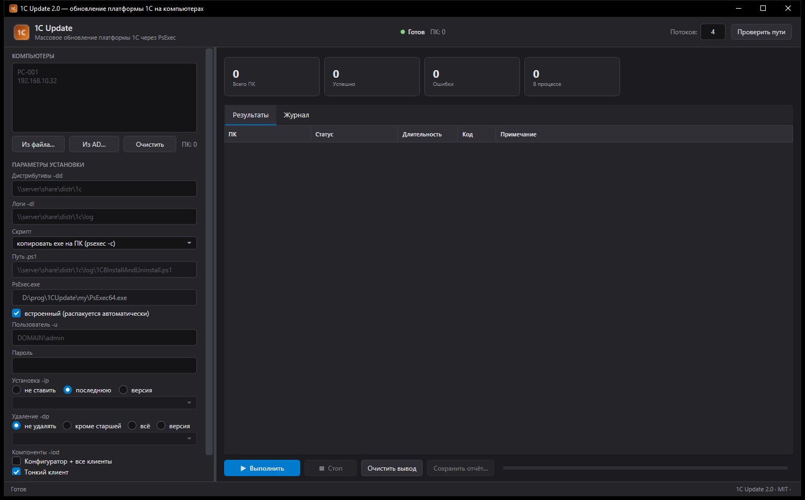
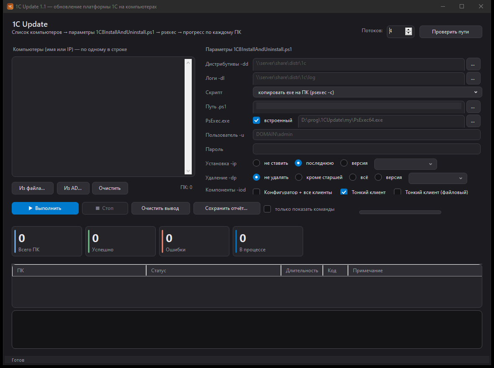

# 1C Update

Небольшая утилита для массового обновления платформы **1С:Предприятие 8** на компьютерах домена.
Одно окно: список ПК → параметры установки → запуск через `PsExec` → живой прогресс по каждой машине.

Скрипт установки **вшит в сам `.exe`** — держать `.ps1` на шаре не обязательно.

[](https://t.me/mr_sumin)


**Версия 2.0.0 (WPF)** · WinForms-версия 1.1 — в `src/` · [CHANGELOG](CHANGELOG.md) · [MIT](LICENSE) · [Написать в Telegram](https://t.me/mr_sumin)



> **WPF-версия 2.0** — основная: [`wpf/1CUpdate.Wpf`](wpf/1CUpdate.Wpf/README.md).
> Собирается в **один самодостаточный exe** (~64 МБ): `powershell -File build-wpf.ps1 -Publish`.
>
> WinForms-версия 1.1 (исходник `src/Update1C.cs`, сборка `build.ps1`) тоже поддерживается —
> её окно: [`screenshot-winforms.png`](screenshot-winforms.png).

---

## Содержание

- [Что умеет](#что-умеет)
- [Как это работает](#как-это-работает)
- [Быстрый старт](#быстрый-старт)
- [Поля окна](#поля-окна)
- [Параметры скрипта](#параметры-скрипта)
- [Статусы](#статусы)
- [Сборка из исходников](#сборка-из-исходников)
- [Структура репозитория](#структура-репозитория)
- [Настройки](#настройки)
- [Диагностика](#диагностика)
- [Ограничения и нюансы](#ограничения-и-нюансы)

---

## Что умеет

- **Список ПК**: ввод вручную (имя или IP, по одному в строке), загрузка из файла
  (`c:\inst\comp.txt` подставляется по умолчанию), выбор из Active Directory **деревом OU**.
- **Параметры установки/удаления** полностью повторяют ключи скрипта:
  `-ip` (какую версию ставить), `-dp` (что удалять), `-iod` (какие клиентские компоненты).
- **Запуск через PsExec** от указанной учётной записи, параллельно (1–64 потоков).
- **Живой прогресс**: статус, длительность и код возврата по каждому ПК + общий журнал.
- **Проверка до установки**: если нужная версия уже стоит — установка не запускается,
  ПК помечается как «Уже установлена».
- **Проверка после установки**: версия подтверждается чтением реестра на самом ПК.
- **Свой файл прогресса на каждый запуск** — окно видит шаги даже если PsExec потеряет вывод.
- **Самоочистка**: копия программы, которую PsExec кладёт на целевой ПК, удаляется после работы.
- **Отчёт** по всем машинам в CSV/TXT.

## Как это работает

```
                 ваша машина                                  целевой ПК
┌──────────────────────────────────┐          ┌─────────────────────────────────────┐
│ 1CUpdate.exe (окно)              │  SMB     │ PSEXESVC (ставит сам PsExec)        │
│  ├─ PsExec.exe (вшит в exe)      │ ───────► │  └─ 1CUpdate.exe --remote-worker    │
│  ├─ 1C8InstallAndUninstall.ps1   │  RPC     │       ├─ распаковывает скрипт в temp│
│  └─ список ПК, параметры         │          │       ├─ запускает powershell       │
│                                  │ ◄─────── │       └─ отдаёт лог обратно (stdout)│
└──────────────────────────────────┘  вывод  └─────────────────────────────────────┘
```

1. Окно формирует для каждого ПК команду вида:

   ```
   psexec \\PC-001 -s -accepteula -u "DOMAIN\admin" -p "***" ^
     -c -f "C:\...\1CUpdate.exe" --remote-worker ^
     -dd "\\server\share\distr\1c" -dl "\\server\share\distr\1c\log" ^
     -ip "8.3.27.2342" -dp "no" ^
     -iod "DESIGNERALLCLIENTS=0 THINCLIENT=1 THINCLIENTFILE=0"
   ```

   `-c -f` — PsExec копирует наш exe на целевой ПК и запускает его там от SYSTEM.

2. На ПК наш же exe в режиме `--remote-worker` распаковывает встроенный скрипт во временный
   каталог, выполняет его и удаляет. Всё, что печатает скрипт и он сам, уходит в вывод
   PsExec и в файл прогресса на шаре.

3. Окно читает **оба** канала (вывод PsExec и файл прогресса), дубли отбрасывает.

4. После работы копия `C:\Windows\1CUpdate.exe` удаляется через административную шару `C$`.

**Сам PsExec на целевые ПК не устанавливается** — он по SMB/RPC поднимает там свою службу
`PSEXESVC`, выполняет команду и убирает её за собой.

### Три способа доставки скрипта (поле «Скрипт»)

| Режим | Что происходит | Что нужно на шаре |
|---|---|---|
| **копировать exe на ПК** (по умолчанию) | PsExec копирует `1CUpdate.exe` и запускает его на ПК | ничего |
| **выложить .ps1 на шару** | программа записывает встроенный `.ps1` в указанный путь, PsExec запускает его оттуда | каталог с правом записи |
| **внешний .ps1** | запускается ваш файл по указанному пути | ваш `.ps1` |

## Быстрый старт

1. Запустите `1CUpdate.exe` (или соберите его сами, см. ниже).
2. Заполните пути: каталог дистрибутивов, каталог логов, путь к скрипту (примеры показаны
   серым прямо в полях). Значения сохраняются и подставляются при следующем запуске.
3. Вставьте список компьютеров — имена или IP, по одному в строке — либо загрузите из файла,
   либо выберите в AD (**Из AD…** → дерево подразделений).
4. Нажмите **Проверить пути** — программа проверит каталоги, скрипт и PsExec, а заодно
   найдёт версии в каталоге дистрибутивов и заполнит списки версий.
5. Выберите, что делать: установка, удаление, компоненты.
6. Введите пароль учётной записи (один раз на запуск; на диск не пишется).
7. **▶ Выполнить** (F5). Остановка — **■ Стоп** (F6).

Для проверки параметров без запуска есть галочка **«только показать команды»** —
она печатает готовые командные строки в журнал.

## Поля окна

| Поле | Назначение |
|---|---|
| **Компьютеры** | список ПК: имя (`PC-001`) или IP (`192.168.10.32`), по одному в строке |
| **Из файла…** | загрузить список из txt (по умолчанию открывается `c:\inst\comp.txt`) |
| **Из AD…** | дерево OU домена, справа компьютеры выбранного подразделения |
| **Дистрибутивы -dd** | каталог с папками вида `8.3.27.2342-64` (внутри MSI и `setup.ini`) |
| **Логи -dl** | куда каждый ПК пишет `<ИМЯ_ПК>.log`; каталог создаётся автоматически |
| **Скрипт** | способ доставки скрипта (см. таблицу выше) |
| **Путь .ps1** | путь к `.ps1` на шаре — назначение зависит от режима |
| **PsExec.exe** | встроен в программу; галочку «встроенный» можно снять и указать свой файл |
| **Пользователь -u / Пароль** | учётка для подключения. Доменная: `DOMAIN\admin`; локальный админ ПК: `.\Administrator` |
| **Установка -ip** | не ставить / последнюю версию из `-dd` / конкретную версию |
| **Удаление -dp** | не удалять / всё кроме старшей / всё / конкретную версию |
| **Компоненты -iod** | конфигуратор + все клиенты / тонкий клиент / тонкий клиент (файловый) |
| **Потоков** | сколько ПК обрабатывать одновременно (1–64) |
| **Проверить пути** | проверка доступности каталогов, скрипта, PsExec и поиск версий |

## Параметры скрипта

| Ключ | Значения |
|---|---|
| `-dd` | каталог дистрибутивов |
| `-dl` | каталог журналов |
| `-ip` | `no`, `last`, `8.3.27.2342` |
| `-dp` | `no`, `ael` (всё кроме старшей), `all`, `8.3.27.2342` |
| `-iod` | `DESIGNERALLCLIENTS=0\|1 THINCLIENT=0\|1 THINCLIENTFILE=0\|1` |

`-iod`: `DESIGNERALLCLIENTS` — конфигуратор (в англ. версии Designer) и все клиенты;
`THINCLIENT` — тонкий клиент; `THINCLIENTFILE` — тонкий клиент для файловых баз.
При включённом конфигураторе две нижние галочки включаются автоматически.

## Статусы

| Статус | Значение |
|---|---|
| **Готово** | версия установлена и подтверждена чтением реестра после установки |
| **Уже установлена** | нужная версия уже была — установка не запускалась |
| **С замечаниями** | завершилось, но итог не подтверждён либо в журнале есть ошибки |
| **Ошибка** | код PsExec ≠ 0 либо версия после установки не найдена |
| **Отменено** | остановлено пользователем |

## Сборка из исходников

### WPF-версия 2.0 (основная)

Нужен **.NET 8 SDK** (https://dotnet.microsoft.com/download/dotnet/8.0).

```powershell
# сборка в bin\Release
powershell -ExecutionPolicy Bypass -File .\build-wpf.ps1

# один самодостаточный exe -> wpf\1CUpdate.Wpf\publish\1CUpdate.exe (~64 МБ)
powershell -ExecutionPolicy Bypass -File .\build-wpf.ps1 -Publish

# то же, но папкой (если в %TEMP% запрещена распаковка single-file)
powershell -ExecutionPolicy Bypass -File .\build-wpf.ps1 -Publish -Folder
```

Что вшивается в exe: скрипт `1C8InstallAndUninstall.ps1`, PsExec x86/x64 и standalone-воркер
(WinForms `1CUpdate.exe`), который `psexec -c` копирует на целевые ПК.
Поэтому порядок сборки: сначала `build.ps1` (воркер), потом `build-wpf.ps1 -Publish`.

### WinForms-версия 1.1



Нужен только Windows и .NET Framework 4.x (компилятор `csc.exe` уже есть в системе).
Сторонних библиотек нет — всё на WinForms из состава .NET.

```powershell
# обычная сборка: скрипт из my\ вшивается, PsExec — если лежит в my\ или рядом
powershell -ExecutionPolicy Bypass -File .\build.ps1

# со своим PsExec (x86 и x64) внутри exe
powershell -ExecutionPolicy Bypass -File .\build.ps1 -PsExec C:\inst\PsExec.exe -PsExec64 C:\inst\PsExec64.exe

# со своим скриптом
powershell -ExecutionPolicy Bypass -File .\build.ps1 -ScriptFile .\my\1C8InstallAndUninstall-1.09.ps1
```

Что делает `build.ps1`:

1. генерирует иконку `app.ico` (если её нет) скриптом `make-icon.ps1`;
2. вшивает внутрь exe ресурсы: `script.ps1` — скрипт установки, `psexec.exe` / `psexec64.exe` — PsTools;
3. собирает `1CUpdate.exe` через `csc.exe` с манифестом (DPI-awareness, `asInvoker`);
4. если старый exe запущен — переименовывает его в `1CUpdate.old.exe` и собирает новый.

Флаги: `-NoIcon` (без иконки), `-Run` (собрать и запустить), `-PsExec`, `-PsExec64`, `-ScriptFile`.

Готовую сборку удобно выкладывать не в репозиторий, а в **Releases** (GitHub → Releases → Attach binaries):
в `.gitignore` exe, иконка и бинарники PsTools исключены, в репозитории остаются исходники и скрипт.

### Где взять PsExec

[PsTools](https://learn.microsoft.com/sysinternals/downloads/pstools) — бесплатный набор
Microsoft Sysinternals. Нужны `PsExec.exe` (x86) и `PsExec64.exe` (x64). Положите их в папку
`my\` перед сборкой — они попадут внутрь exe, и носить их отдельно не придётся.
Из репозитория эти бинарники намеренно не выкладываются: скачайте с сайта Microsoft.

## Структура репозитория

```
1CUpdate.exe                       собранная программа (в репозиторий не кладётся — см. .gitignore)
src/Update1C.cs                    весь исходник: окно, AD-диалог, раннер, режим --remote-worker
build.ps1                          сборка через csc.exe
make-icon.ps1                      генерация app.ico
app.manifest                       манифест (DPI, asInvoker)
my/1C8InstallAndUninstall-1.09.ps1 исходник встроенного скрипта установки
my/PsExec.exe, my/PsExec64.exe      PsTools для вшивания (скачать отдельно)
tests/fake-psexec*.cs|cmd|ps1      имитация PsExec для автотеста окна
screenshot.png                     вид окна
README.md                          этот файл
CHANGELOG.md                       история изменений
LICENSE                            лицензия MIT
.gitignore                         что не кладём в репозиторий
```

Исходник — один файл `src/Update1C.cs`, внутри которого:

| Класс | Что делает |
|---|---|
| `Program` | точка входа, режимы `--remote-worker`, `--cli`, `--commands` |
| `MainForm` | главное окно: список ПК, параметры, таблица результатов, журнал |
| `AdDialog` | выбор компьютеров из AD: дерево OU + список |
| `Runner` | очередь ПК, потоки, запуск PsExec, чтение вывода и файла прогресса |
| `RemoteWorker` | режим, который исполняется на целевом ПК: распаковка и запуск скрипта |
| `Options` | параметры запуска и сборка командной строки PsExec |
| `Core`/`Embedded`/`LogTail`/`CrashLog` | работа с дистрибутивом, ресурсами, логами, падениями |

## Настройки

Пути, список ПК, режимы и значения полей хранятся в `%APPDATA%\1CUpdate\settings.ini`
и подставляются при следующем запуске. Если `%APPDATA%` недоступна — рядом с exe
в `1CUpdate.settings.ini`. Свой файл можно задать переменной окружения `ONECUPDATE_CONFIG`.

Пароль **не сохраняется** — вводится один раз на запуск.

## Диагностика

- **Двойной клик по строке ПК** — открыть файл журнала этого ПК (если логи пишутся на шару).
- **Файл прогресса** `<dl>\<ПК>.<id>.progress.txt` — шаги, которые выполнил процесс на ПК.
  При успехе удаляется, при ошибке остаётся для разбора.
- **Аварийный след** на целевом ПК: `C:\Windows\Temp\1CUpdate-crash.log`
  (доступен как `\\<ПК>\C$\Windows\Temp\1CUpdate-crash.log`), плюс `%TEMP%\1CUpdate-crash.log`.
- **Копия программы на ПК занята** (остался процесс от прошлого запуска) — программа сама
  снимет блокировку и повторит. Вручную то же самое:

  ```
  psexec \\<ПК> -s -accepteula -u <домен\пользователь> -p <пароль> taskkill /f /im 1CUpdate.exe
  ```

## SmartScreen и подпись

При первом запуске Windows может показать «Система Windows защитила ваш компьютер»
(фильтр SmartScreen). Это не вирус: exe не подписан, а у файла стоит метка «скачано
из интернета» (Mark-of-the-Web).

Что делать:

1. **Разово:** «Подробнее» → «Выполнить в любом случае».
2. **Снять метку** с файла:

   ```powershell
   Unblock-File .\1CUpdate.exe
   ```

   или правой кнопкой → Свойства → «Разблокировать».

3. **Подписать** exe сертификатом code signing — правильное решение:

   ```powershell
   .\sign.ps1 -File .\wpf\1CUpdate.Wpf\publish\1CUpdate.exe -Pfx C:\certs\my.pfx -Password ***
   # или сертификатом из хранилища
   .\sign.ps1 -File .\1CUpdate.exe -Thumbprint <отпечаток>
   ```

   Нужен `signtool.exe` (Windows SDK, компонент «Signing Tools for Desktop Apps»)
   и сертификат. **EV-сертификат** даёт репутацию сразу, **OV** — накапливает её
   со временем. Самоподписанный сертификат SmartScreen не обходит.

4. **Сообщить Microsoft** о ложном срабатывании:
   <https://www.microsoft.com/en-us/wdsi/filesubmission>

5. **В домене** раскладывать через GPO/Intune или сетевую шару: при копировании
   по SMB метка «из интернета» не ставится, и предупреждение обычно не появляется.

Дополнительно: single-file сборка (самораспаковка в `%TEMP%`) и встроенный PsExec
повышают подозрительность эвристик. Сборка папкой (`build-wpf.ps1 -Publish -Folder`)
вместе с подписью снижает шанс ложного срабатывания.

## Ограничения и нюансы

- **Серверную часть 1С программа не ставит** — только клиентские MSI (конфигуратор/клиенты).
- **`-dp all` удаляет всё, что начинается с `1С`/`1C`**, включая сервер, если он установлен
  на этом ПК. Используйте осознанно.
- **Скрипт должен быть неинтерактивным**: ввод (`Read-Host`) не поддерживается, stdin закрыт.
- **Пароль виден в командной строке процесса** (`-p`) — это ограничение PsExec.
- **Права**: учётная запись должна быть локальным администратором на целевых ПК.
  Для локальных админов (`.\Administrator`) Windows по умолчанию режет удалённый доступ
  к `ADMIN$` — нужен `LocalAccountTokenFilterPolicy=1` на ПК или доменная учётка.
- **IP-адреса**: работают во всех режимах. В режиме «выложить .ps1 на шару» журнал скрипта
  именуется по настоящему имени ПК, поэтому для IP окно пробует обратный DNS.
- **Антивирус** может не любить копирование exe в `C:\Windows` — добавьте исключение
  или используйте режим «скрипт на шаре».

## Связь

Вопросы, идеи, баг-репорты — в Telegram:

[](https://t.me/mr_sumin)

Автор: **@mr_sumin** — <https://t.me/mr_sumin>

## Лицензия и товарные знаки

Код распространяется по лицензии [MIT](LICENSE). В репозиторий **не входят** бинарники PsExec: они принадлежат Microsoft
(Sysinternals) и скачиваются отдельно. «1С:Предприятие» — товарный знак фирмы «1С»;
проект не связан с фирмой «1С» и не является её продуктом.
